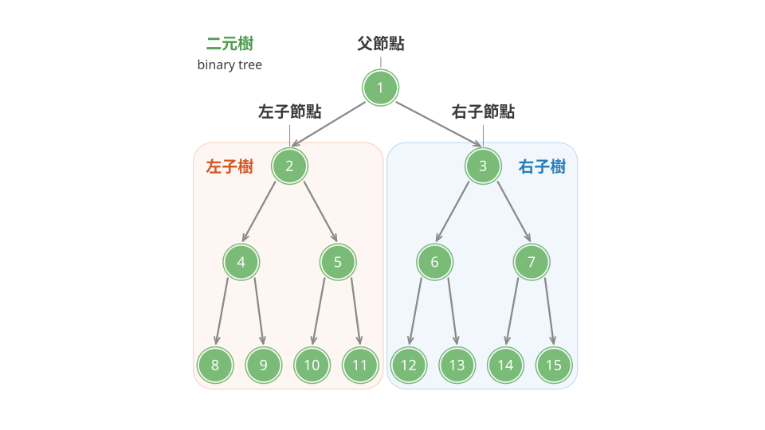
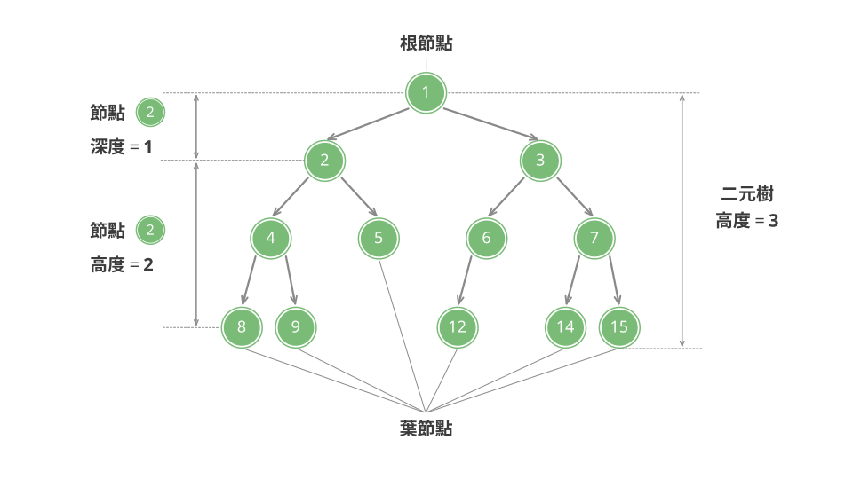
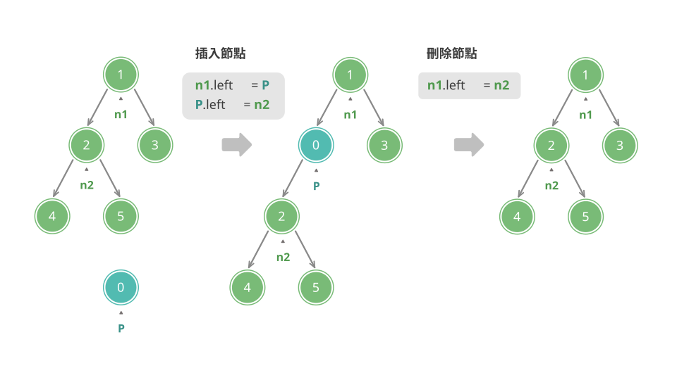

# 二元樹

<u>二元樹（binary tree）</u>是一種非線性資料結構，代表“祖先”與“後代”之間的派生關係，體現了“一分為二”的分治邏輯。與鏈結串列類似，二元樹的基本單元是節點，每個節點包含值、左子節點引用和右子節點引用。

```snippet
tree_node_class
```

每個節點都有兩個引用（指標），分別指向<u>左子節點（left-child node）</u>和<u>右子節點（right-child node）</u>，該節點被稱為這兩個子節點的<u>父節點（parent node）</u>。當給定一個二元樹的節點時，我們將該節點的左子節點及其以下節點形成的樹稱為該節點的<u>左子樹（left subtree）</u>，同理可得<u>右子樹（right subtree）</u>。

**在二元樹中，除葉節點外，其他所有節點都包含子節點和非空子樹**。如下圖所示，如果將“節點 2”視為父節點，則其左子節點和右子節點分別是“節點 4”和“節點 5”，左子樹是“節點 4 及其以下節點形成的樹”，右子樹是“節點 5 及其以下節點形成的樹”。



## 二元樹常見術語

二元樹的常用術語如下圖所示。

- <u>根節點（root node）</u>：位於二元樹頂層的節點，沒有父節點。
- <u>葉節點（leaf node）</u>：沒有子節點的節點，其兩個指標均指向 `None` 。
- <u>邊（edge）</u>：連線兩個節點的線段，即節點引用（指標）。
- 節點所在的<u>層（level）</u>：從頂至底遞增，根節點所在層為 1 。
- 節點的<u>度（degree）</u>：節點的子節點的數量。在二元樹中，度的取值範圍是 0、1、2 。
- 二元樹的<u>高度（height）</u>：從根節點到最遠葉節點所經過的邊的數量。
- 節點的<u>深度（depth）</u>：從根節點到該節點所經過的邊的數量。
- 節點的<u>高度（height）</u>：從距離該節點最遠的葉節點到該節點所經過的邊的數量。



!!! tip

    請注意，我們通常將“高度”和“深度”定義為“經過的邊的數量”，但有些題目或教材可能會將其定義為“經過的節點的數量”。在這種情況下，高度和深度都需要加 1 。

## 二元樹基本操作

### 初始化二元樹

與鏈結串列類似，首先初始化節點，然後構建引用（指標）。

```snippet
init_binary_tree
```

??? pythontutor "視覺化執行"

    @tutor init_binary_tree_tutor

### 插入與刪除節點

與鏈結串列類似，在二元樹中插入與刪除節點可以透過修改指標來實現。下圖給出了一個示例。



```snippet
insert_remove_node
```

??? pythontutor "視覺化執行"

    @tutor insert_remove_node_tutor

!!! tip

    需要注意的是，插入節點可能會改變二元樹的原有邏輯結構，而刪除節點通常意味著刪除該節點及其所有子樹。因此，在二元樹中，插入與刪除通常是由一套操作配合完成的，以實現有實際意義的操作。

## 常見二元樹型別

### 完美二元樹

如下圖所示，<u>完美二元樹（perfect binary tree）</u>所有層的節點都被完全填滿。在完美二元樹中，葉節點的度為 $0$ ，其餘所有節點的度都為 $2$ ；若樹的高度為 $h$ ，則節點總數為 $2^{h+1} - 1$ ，呈現標準的指數級關係，反映了自然界中常見的細胞分裂現象。

!!! tip

    請注意，在中文社群中，完美二元樹常被稱為<u>滿二元樹</u>。


### 完全二元樹

如下圖所示，<u>完全二元樹（complete binary tree）</u>僅允許最底層的節點不完全填滿，且最底層的節點必須從左至右依次連續填充。請注意，完美二元樹也是一棵完全二元樹。


### 完滿二元樹

如下圖所示，<u>完滿二元樹（full binary tree）</u>除了葉節點之外，其餘所有節點都有兩個子節點。


### 平衡二元樹

如下圖所示，<u>平衡二元樹（balanced binary tree）</u>中任意節點的左子樹和右子樹的高度之差的絕對值不超過 1 。


## 二元樹的退化

下圖展示了二元樹的理想結構與退化結構。當二元樹的每層節點都被填滿時，達到“完美二元樹”；而當所有節點都偏向一側時，二元樹退化為“鏈結串列”。

- 完美二元樹是理想情況，可以充分發揮二元樹“分治”的優勢。
- 鏈結串列則是另一個極端，各項操作都變為線性操作，時間複雜度退化至 $O(n)$ 。


如下表所示，在最佳結構和最差結構下，二元樹的葉節點數量、節點總數、高度等達到極大值或極小值。

<p align="center"> 表 <id> &nbsp; 二元樹的最佳結構與最差結構 </p>

|                             | 完美二元樹         | 鏈結串列    |
| --------------------------- | ------------------ | ------- |
| 第 $i$ 層的節點數量         | $2^{i-1}$          | $1$     |
| 高度為 $h$ 的樹的葉節點數量 | $2^h$              | $1$     |
| 高度為 $h$ 的樹的節點總數   | $2^{h+1} - 1$      | $h + 1$ |
| 節點總數為 $n$ 的樹的高度   | $\log_2 (n+1) - 1$ | $n - 1$ |
