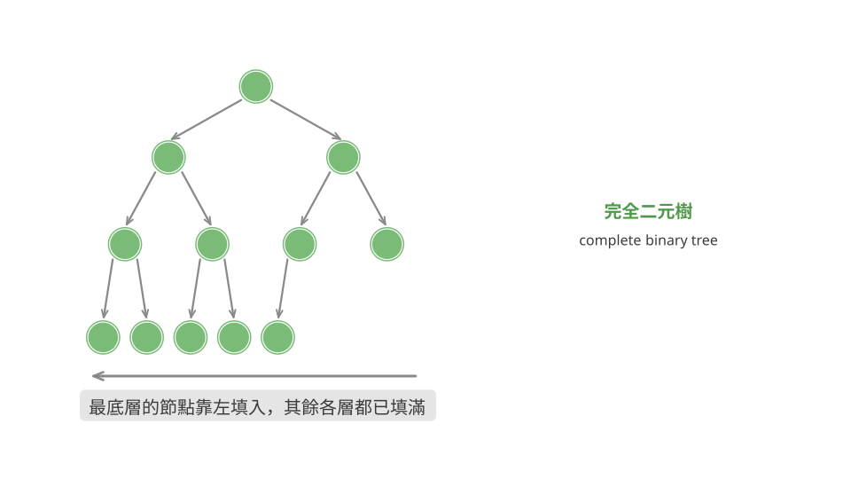
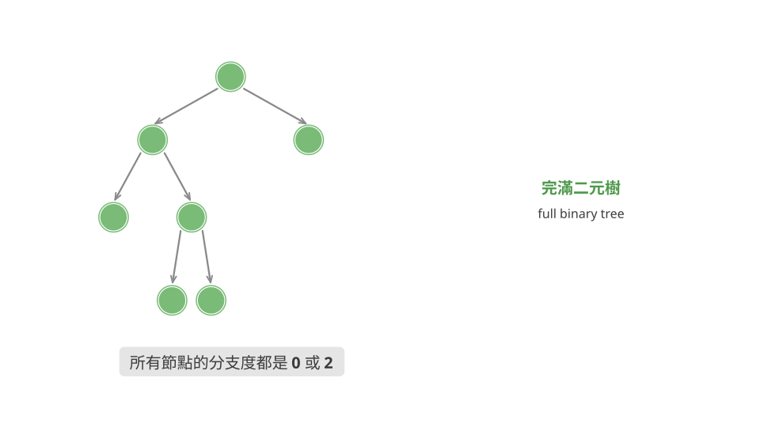

# 二元樹

<u>二元樹（binary tree）</u>是一種非線性資料結構，用來表示「祖先」與「後代」之間的衍生關係，體現了將問題「一分為二」的分治想法。與鏈結串列相似，二元樹的基本單位是節點，每個節點包含節點值，以及左右子節點的參照。

```snippet
tree_node_class
```

每個節點都有兩個參照（指標），分別指向<u>左子節點（left-child node）</u>與<u>右子節點（right-child node）</u>，而該節點就是這兩個子節點的<u>父節點（parent node）</u>。給定二元樹中的一個節點，由它的左子節點及該子節點所有後代形成的樹稱為<u>左子樹（left subtree）</u>，<u>右子樹（right subtree）</u>的定義也相同。

**在二元樹中，除了葉節點，其餘節點都有子節點與非空的子樹**。如下圖所示，以節點 2 為父節點，它的左右子節點分別是節點 4 和節點 5；左子樹是由節點 4 及其所有後代形成的樹，右子樹則是由節點 5 及其所有後代形成的樹。


## 二元樹的常用術語

下圖說明二元樹的常用術語。

- <u>根節點（root node）</u>：位於二元樹最上層，沒有父節點。
- <u>葉節點（leaf node）</u>：沒有子節點，兩個指標都指向 `None`。
- <u>邊（edge）</u>：連接兩個節點的線段，代表節點之間的參照（指標）。
- 節點所在的<u>層（level）</u>：從上往下依序編號，根節點位於第 1 層。
- 節點的<u>分支度（degree）</u>：該節點的子節點數。在二元樹中，分支度可能是 0、1 或 2。
- 二元樹的<u>高度（height）</u>：從根節點到距離最遠的葉節點所經過的邊數。
- 節點的<u>深度（depth）</u>：從根節點到該節點所經過的邊數。
- 節點的<u>高度（height）</u>：從距離該節點最遠的葉節點到該節點所經過的邊數。


!!! tip

    本書通常用「經過的邊數」定義高度與深度，有些題目或教材則用「經過的節點數」來定義。若以節點數計算，高度與深度都要加 1。

## 二元樹的基本操作

### 初始化二元樹

和鏈結串列相同，先初始化節點，再建立參照（指標）。

```snippet
init_binary_tree
```

??? pythontutor "執行視覺化示範"

    @tutor init_binary_tree_tutor

### 插入與刪除節點

和鏈結串列一樣，二元樹也可透過修改指標來插入與刪除節點。下圖是一個例子。


```snippet
insert_remove_node
```

??? pythontutor "執行視覺化示範"

    @tutor insert_remove_node_tutor

!!! tip

    請留意，插入節點可能改變二元樹原本的邏輯結構，刪除節點則通常意味著刪除該節點及其所有子樹。因此，實際在二元樹中插入或刪除節點時，通常需要搭配一系列操作，才能達到想要的效果。

## 常見的二元樹類型

### 完美二元樹

如下圖所示，<u>完美二元樹（perfect binary tree）</u>的每一層都已填滿。葉節點的分支度為 $0$，其餘節點的分支度都是 $2$。若樹高為 $h$，節點總數就是 $2^{h+1} - 1$。這種標準的指數關係也反映了自然界常見的細胞分裂現象。

!!! tip

    在中文社群中，完美二元樹也常稱為<u>滿二元樹</u>。


### 完全二元樹

如下圖所示，<u>完全二元樹（complete binary tree）</u>只有最底層可以未填滿，而且最底層的節點必須從左到右連續排列。完美二元樹也是完全二元樹。



### 完滿二元樹

如下圖所示，<u>完滿二元樹（full binary tree，又稱嚴格二元樹）</u>中除了葉節點，其餘每個節點都有兩個子節點。



### 平衡二元樹

如下圖所示，<u>平衡二元樹（balanced binary tree）</u>中每個節點的左右子樹高度差的絕對值都不超過 1。


## 二元樹的退化

下圖比較二元樹的理想結構與退化結構。當每一層都填滿，就形成「完美二元樹」；若所有節點都偏向同一側，二元樹就會退化成「鏈結串列」。

- 完美二元樹是理想情況，可以充分發揮二元樹分治的優勢。
- 鏈結串列則是另一個極端，各項操作都變成線性操作，時間複雜度退化為 $O(n)$。


如下表所示，在最佳與最差兩種結構下，二元樹的葉節點數、節點總數和高度等分別達到最大值或最小值。

<p align="center"> 表 <id> &nbsp; 二元樹的最佳結構與最差結構 </p>

|                             | 完美二元樹         | 鏈結串列    |
| --------------------------- | ------------------ | ------- |
| 第 $i$ 層的節點數         | $2^{i-1}$          | $1$     |
| 高度為 $h$ 的樹的葉節點數 | $2^h$              | $1$     |
| 高度為 $h$ 的樹的節點總數   | $2^{h+1} - 1$      | $h + 1$ |
| 節點總數為 $n$ 的樹的高度   | $\log_2 (n+1) - 1$ | $n - 1$ |
