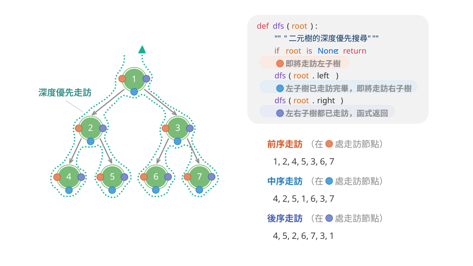
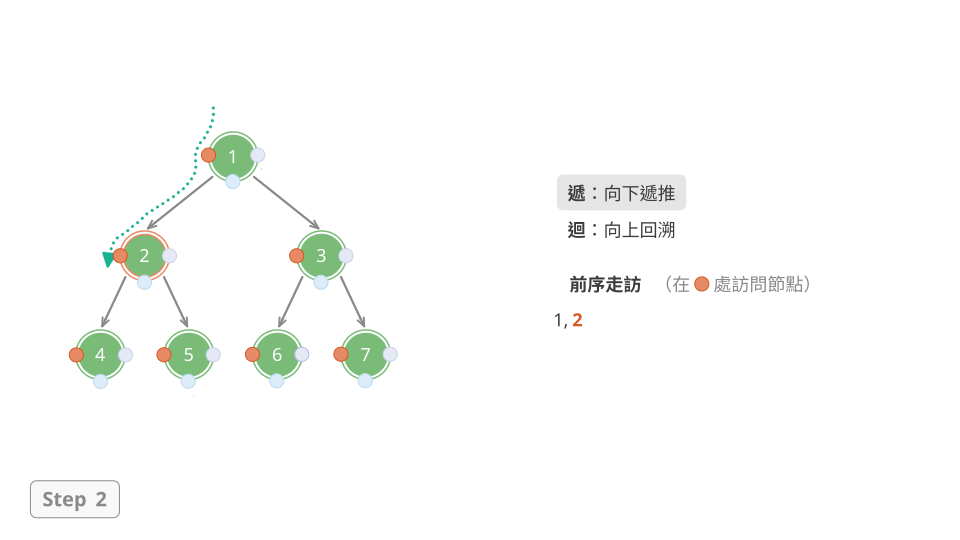
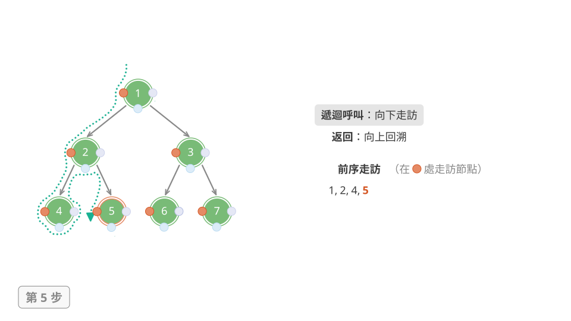
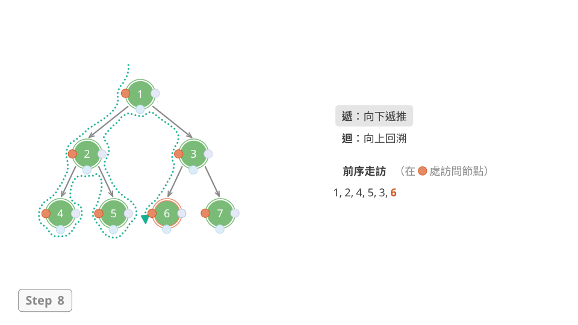
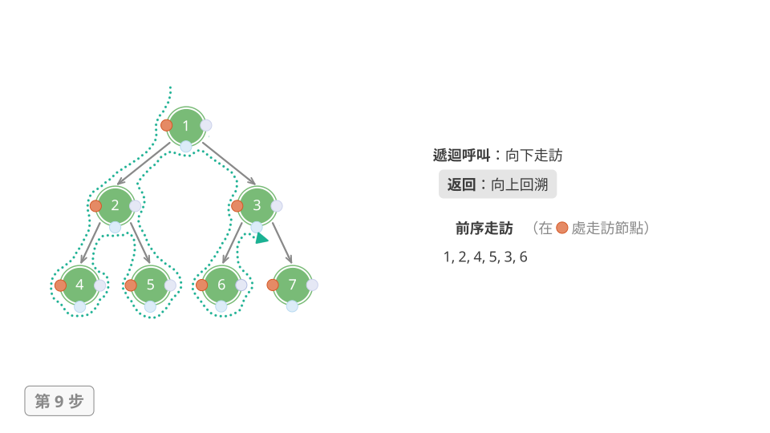
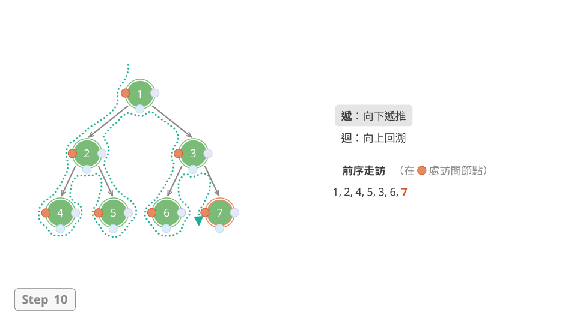

# 二元樹走訪

從實體結構來看，樹是以鏈結串列為基礎的資料結構，因此會透過指標逐一走訪節點。不過，樹屬於非線性資料結構，走訪方式比鏈結串列複雜，需要藉助搜尋演算法。

二元樹常見的走訪方式包括層序、前序、中序與後序走訪。

## 層序走訪

如下圖所示，<u>層序走訪（level-order traversal）</u>從最上層到最底層逐層走訪二元樹，同一層內則由左至右走訪節點。

層序走訪屬於<u>廣度優先走訪（breadth-first traversal）</u>，也稱為<u>廣度優先搜尋（breadth-first search, BFS）</u>。這種走訪方式逐層推進，就像一圈一圈向外擴展。


### 程式實作

廣度優先走訪通常用佇列來實作。佇列遵循「先進先出」的規則，而廣度優先走訪要「逐層推進」，兩者的想法一致。實作程式碼如下：

```src
[file]{binary_tree_bfs}-[class]{}-[func]{level_order}
```

### 複雜度分析

- **時間複雜度為 $O(n)$**：每個節點都走訪一次，需要 $O(n)$ 時間，其中 $n$ 為節點數。
- **空間複雜度為 $O(n)$**：最壞情況發生在滿二元樹中。即將走訪最底層時，佇列裡最多同時有 $(n + 1) / 2$ 個節點，占用 $O(n)$ 空間。

## 前序、中序與後序走訪

前序、中序與後序走訪都屬於<u>深度優先走訪（depth-first traversal）</u>，也稱為<u>深度優先搜尋（depth-first search, DFS）</u>。做法是先沿一條路徑走到底，再回溯繼續走訪。

下圖說明二元樹的深度優先走訪。**可以把深度優先走訪想成沿著整棵二元樹的外圍走一圈**。走過每個節點時，都會經過三個位置，分別對應前序、中序與後序走訪。



### 程式實作

深度優先搜尋通常用遞迴實作：

```src
[file]{binary_tree_dfs}-[class]{}-[func]{post_order}
```

!!! tip

    深度優先搜尋也可以用迭代實作，有興趣的讀者可以自行探索。

下圖呈現前序走訪二元樹的遞迴過程，可分為往下呼叫與向上返回兩個方向相反的部分。

1. 往下遞迴是發出新的方法呼叫，程式在這個過程中走訪下一個節點。
2. 向上返回是讓函式結束呼叫，表示目前的節點已走訪完畢。

=== "<1>"
    

=== "<2>"
    

=== "<3>"
    

=== "<4>"
    

=== "<5>"
    

=== "<6>"
    

=== "<7>"
    

=== "<8>"
    

=== "<9>"
    

=== "<10>"
    

=== "<11>"
    

### 複雜度分析

- **時間複雜度為 $O(n)$**：每個節點都走訪一次，需要 $O(n)$ 時間。
- **空間複雜度為 $O(n)$**：最壞情況下，樹退化為鏈結串列，遞迴深度達到 $n$，系統的堆疊框架共占用 $O(n)$ 空間。
